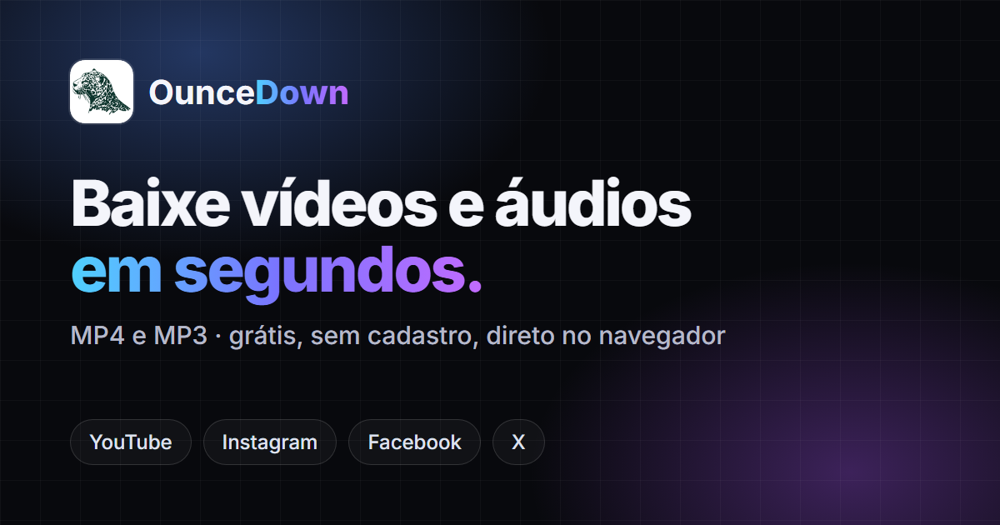

<p align="center">
  
</p>

<h1 align="center">OunceDown</h1>

<p align="center">
  Baixador de vídeos (MP4) e áudios (MP3) do YouTube, Instagram, Facebook e X — direto no navegador, grátis e sem cadastro.
  <br />
  <a href="https://ounc3.com.br"><b>ounc3.com.br</b></a>
</p>

---

## ✨ Destaques

- **Uma caixa, quatro plataformas** — a plataforma é detectada pelo link; o site mostra título, miniatura, duração e só as qualidades que existem no vídeo.
- **Progresso em tempo real** via *Server-Sent Events* (download do vídeo, do áudio e a junção pelo ffmpeg).
- **Vídeo em até 4K** (configurável) ou **áudio MP3** na melhor qualidade disponível.
- **Interface própria**, sem framework: HTML, CSS e JavaScript puros, tema escuro, responsiva e com animações leves.
- **SEO completo** — páginas de entrada por busca (“YouTube para MP3”, “baixar Reels”…), dados estruturados (`WebApplication`, `FAQPage`, `BreadcrumbList`), Open Graph com imagem de capa, sitemap e 404 real.
- **Anúncios não invasivos** — banners isolados em iframes com *sandbox* (sem pop-ups nem redirecionamentos), carregados sob demanda e com espaço reservado (sem “pulo” de layout). Suporta Adsterra e Google AdSense.
- **Leve o bastante para rodar num tablet** — está no ar num tablet Android antigo (1 GB de RAM) com Termux, publicado na internet por um Cloudflare Tunnel.

## 🧱 Tecnologias

| Camada | Uso |
|---|---|
| **Node.js + Express** | API, renderização das páginas e entrega dos arquivos |
| **yt-dlp** | Leitura dos metadados e download das mídias |
| **ffmpeg** | Junção de vídeo + áudio e conversão para MP3 |
| **HTML/CSS/JS puros** | Frontend, sem dependências |
| **Cloudflare** | DNS, HTTPS, cache e túnel até o servidor caseiro |

## 🚀 Rodando localmente

Requer **Node.js 18+**.

```bash
npm install
npm run setup     # baixa o yt-dlp (release oficial) e o ffmpeg
npm start         # http://localhost:3000
```

Para personalizar, copie o modelo de configuração:

```bash
cp site.config.example.json site.config.json
```

`site.config.json` fica fora do Git (guarda domínio, e-mail e chaves de anúncio). Sem ele, o site usa o modelo de exemplo.

### Variáveis de ambiente

| Variável | Padrão | Para que serve |
|---|---|---|
| `PORT` / `HOST` | `3000` / todas | Porta e endereço do servidor |
| `MAX_HEIGHT` | `2160` | Resolução máxima oferecida (ex.: `720` em máquinas fracas) |
| `MAX_CONCURRENT` | `3` | Downloads simultâneos |
| `YTDLP_PATH` / `FFMPEG_PATH` | `./bin` ou `PATH` | Usar binários do sistema (ex.: instalados pelo gerenciador de pacotes) |
| `YTDLP_JS_RUNTIMES` | — | Runtime JavaScript para o yt-dlp resolver desafios do YouTube (ex.: `node`) |
| `TMP_DIR` | `./tmp` | Pasta dos arquivos temporários (apagados após 30 min) |

### Proteção contra abuso

A análise de um link (yt-dlp) é a operação mais pesada do servidor. Para que poucos pedidos não derrubem uma máquina fraca, o OunceDown tem quatro camadas de proteção:

- **Limite por visitante:** número máximo de análises por minuto e de downloads a cada 10 minutos. Atrás do Cloudflare Tunnel, o IP real vem do cabeçalho `CF-Connecting-IP`, aceito apenas em conexões locais (do `cloudflared`).
- **Um pedido por visitante de cada vez:** uma análise e um download por IP.
- **Fila global:** poucas análises rodam ao mesmo tempo; o excesso espera numa fila curta ou recebe `429 Servidor ocupado` na hora, sem gastar CPU.
- **Cache:** o resultado de um link vale 30 minutos (erros, 2 minutos), e pedidos iguais simultâneos compartilham a mesma análise.

| Variável | Padrão | Para que serve |
|---|---|---|
| `MAX_INFO_CONCURRENT` | `2` | Análises rodando ao mesmo tempo |
| `INFO_QUEUE_MAX` | `4` | Análises que podem esperar na fila |
| `INFO_QUEUE_WAIT_MS` | `60000` | Tempo máximo esperando na fila |
| `INFO_TIMEOUT_MS` | `90000` | Tempo máximo de uma análise |
| `RATE_INFO_PER_MIN` | `8` | Análises por visitante por minuto |
| `RATE_JOBS_PER_10MIN` | `6` | Downloads por visitante a cada 10 minutos |

No tablet de 1 GB de RAM: `MAX_INFO_CONCURRENT=1`, `INFO_QUEUE_MAX=3`, `RATE_INFO_PER_MIN=6`, `RATE_JOBS_PER_10MIN=4`. Para proteção na borda, combine com uma regra de *rate limiting* em `/api/*` no painel da Cloudflare.

## ⚙️ Configuração (`site.config.json`)

| Campo | Para que serve |
|---|---|
| `siteName`, `siteUrl`, `contactEmail`, `owner` | Identidade do site (páginas, políticas, `robots.txt`, `sitemap.xml`) |
| `policiesUpdated` | Data mostrada nas páginas legais |
| `ads.provider` | `"adsterra"` ou `"adsense"` |
| `ads.showPlaceholders` | `false` esconde os marcadores “Seu anúncio aqui” |
| `ads.adsterra.scriptUrl` | `src` do código da Adsterra com `{key}` no lugar da chave |
| `ads.adsterra.banner728` / `banner320` / `banner160` | Chaves dos banners (computador, celular e laterais) |
| `adsense.client` / `adsense.slots` | `ca-pub-…` e IDs dos blocos, se usar AdSense (gera `/ads.txt` e a verificação) |

O arquivo é relido a cada requisição — não precisa reiniciar o servidor.

## 🗂️ Estrutura

```
server.js            API Express, páginas, sitemap, robots, ads.txt
seo-pages.js         Títulos, textos e perguntas de cada página de entrada
public/
  index.html         Modelo único das páginas (placeholders {{...}})
  app.js             Interface: análise do link, opções, progresso (SSE)
  ads.js             Espaços de anúncio (Adsterra / AdSense)
  styles.css         Estilos
  privacidade.html   Política de Privacidade (LGPD)
  termos.html        Termos de Uso
  brand/             Logo, ícones e imagem de compartilhamento
scripts/setup.js     Baixa yt-dlp e ffmpeg
```

### API

| Método | Rota | Descrição |
|---|---|---|
| `POST` | `/api/info` | Metadados do link (título, miniatura, duração, qualidades) |
| `POST` | `/api/jobs` | Inicia um download (`kind`: `video` ou `audio`, `quality`) |
| `GET` | `/api/jobs/:id/events` | Progresso em tempo real (SSE) |
| `GET` | `/api/jobs/:id/file` | Entrega o arquivo pronto |
| `DELETE` | `/api/jobs/:id` | Cancela e apaga o download |

## ⚖️ Uso responsável

Baixe apenas conteúdos seus, de domínio público ou com autorização do autor, respeitando os direitos autorais e os termos de uso de cada plataforma.

---

<p align="center">Um projeto <b>Ounc3</b> · feito por <a href="https://github.com/MajorCaio">MajorCaio</a></p>
